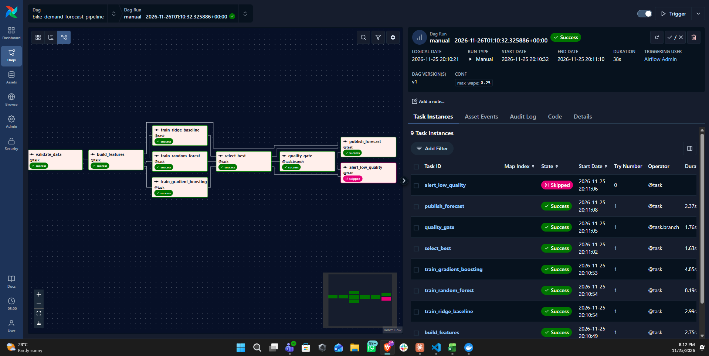
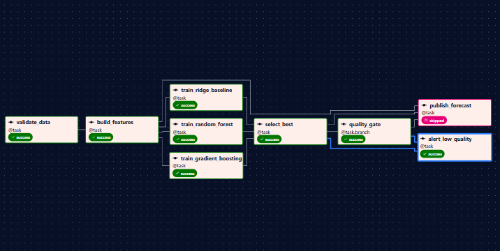
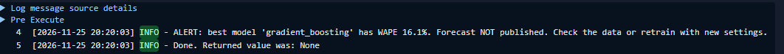

# Airflow Lab (Modified): Weekly Bike-Demand Forecast Pipeline

A modified version of `Labs/Airflow_Labs/Lab_1` from the Northeastern MLOps course
([raminmohammadi/MLOps](https://github.com/raminmohammadi/MLOps)).

**Apache Airflow** runs pipelines: a set of tasks, in a set order, on a schedule, with automatic retries.
A pipeline is called a **DAG** (directed acyclic graph).

This project's DAG, `bike_demand_forecast_pipeline`, forecasts **hourly bike-rental demand** every Monday:

```
validate_data → build_features → ┌ train_ridge_baseline    ┐ → select_best → quality_gate ┌→ publish_forecast
                                  ├ train_random_forest     ┤                              └→ alert_low_quality
                                  └ train_gradient_boosting ┘
                                     (run in parallel)                                  (only one of these runs)
```

## What I changed from the original lab

### The DAG (the lab's core concept)

| Area | Original (`dags/airflow.py`) | My version (`dags/bike_demand_pipeline.py`) |
|---|---|---|
| Code style | Classic `PythonOperator` objects | Modern **TaskFlow API** (`@dag`, `@task`, `@task.branch` from `airflow.sdk`) |
| Shape | 4 tasks in a single line | 9 tasks: data check → features → **3 training tasks in parallel** (fan-out) → join → **branch** |
| Data quality | None | `validate_data` fails the run early if columns are missing, there are too few rows, or demand is missing/negative |
| Branching | None | `quality_gate` (`@task.branch`) runs `publish_forecast` only if WAPE ≤ `max_wape`, otherwise `alert_low_quality`; the other path is **skipped** |
| Schedule | None (manual only) | **Every Monday 06:00 UTC** (`0 6 * * 1`), `catchup=False` |
| Reliability | `retries: 0` | `retries: 2`, `retry_delay: 1 min`, `execution_timeout: 15 min` on every task |
| Run settings | None | `params`: `max_wape` (0–1) can be changed in the **Trigger** form |
| Passing data between tasks | The whole dataset, pickled and base64-encoded, through XCom | Only **small summaries and file paths** through XCom; data lives in files |
| Outputs | Model saved inside the `dags` folder | One folder **per run** in `working_data/` (Windows-safe folder names) with data, 3 models, `forecast.csv`, `report.json` |
| Documentation | None in the UI | `doc_md` shows the pipeline description in the Airflow UI; tags for filtering |
| Code layout | ML logic mixed with serialization | Plain, testable ML functions in `dags/src/forecasting.py`; the DAG file only wires tasks |

### Bugs in the original that this version avoids
- It saved the **49-cluster** K-Means model (the last one in the loop), not the number of clusters the elbow method chose.
- It predicted on **unscaled** test data although the model was trained on scaled data.

### Dataset and model

| Area | Original | My version |
|---|---|---|
| Dataset | Credit-card customers (`file.csv`) | **Bike Sharing Demand** (OpenML v2): 17,379 hours of real rentals, 2011–2012 (`dags/data/bike_demand_hourly.csv`) |
| Problem | Clustering (customer groups) | **Demand forecasting** (regression): bikes rented per hour |
| Model | K-Means + elbow method | **3 models compared**: Ridge (baseline), Random Forest, Gradient Boosting. The best by WAPE is published |
| Split | None | **Time-based**: first 80% of hours to train, last 20% as the "future" test period |
| Scores | SSE / elbow | RMSE, MAE, **WAPE**, **bias** (demand-planning scores) |

### Setup
| Area | Original | My version |
|---|---|---|
| Packages | `_PIP_ADDITIONAL_REQUIREMENTS` (reinstalled at every start) | **Custom Docker image** (`Dockerfile` + `requirements.txt`), built once |
| Setup script | `setup.sh` (Mac/Linux only) | Step-by-step commands for **Windows PowerShell** and Mac/Linux (below) |
| Compose file | Official file | Official Airflow 3.4.0 file + `build: .`, a `working_data` volume, and example DAGs turned off |

## Results (passed run, `max_wape = 0.25`)

| Model | WAPE | RMSE | Result |
|---|---|---|---|
| **gradient_boosting** | **16.1%** | **62.37** | Winner, published (MAE 40.13, bias −4.1%) |
| random_forest | 19.5% | 73.85 | |
| ridge_baseline | 55.0% | 182.85 | Baseline; can't follow rush-hour peaks |

The whole run takes about 40 seconds. A run with `max_wape = 0.10` is **blocked** by the quality gate, and no forecast is published.

## Project structure

```
Dockerfile                        <- custom Airflow image (Airflow 3.4.0 + scikit-learn + pandas)
requirements.txt                  <- packages baked into the image
docker-compose.yaml               <- official Airflow 3.4.0 file, with my 3 edits (see "Setup" table)
dags/
  bike_demand_pipeline.py         <- the DAG: tasks, order, schedule, retries, branch
  src/forecasting.py              <- plain ML functions (validate, features, train, pick best, publish)
  src/__init__.py
  data/bike_demand_hourly.csv     <- input data
assets/                           <- screenshots for this README
```

## What you need to install

1. **Docker Desktop** (tested with Docker Engine 29.8.2): https://www.docker.com/products/docker-desktop
   - Give Docker **at least 4 GB of memory** (8 GB is better). On Windows with WSL 2 this is usually automatic.
2. **Git**: https://git-scm.com/downloads

You don't need Python on your computer. Airflow and all packages run inside Docker.

## Setup (first time, about 10 minutes)

Open **Docker Desktop** and wait for **Engine running**. Then, in a terminal:

```
git clone https://github.com/dheerajkusuma17/airflow-lab.git
cd airflow-lab
```

Create the folders Airflow needs and the settings file:

**Windows (PowerShell):**
```
mkdir logs, plugins, config, working_data
Set-Content .env "AIRFLOW_UID=50000"
Add-Content .env "FERNET_KEY="
```
**macOS/Linux:**
```
mkdir -p logs plugins config working_data
echo "AIRFLOW_UID=$(id -u)" > .env
echo "FERNET_KEY=" >> .env
```

Build the image, prepare Airflow's database, and start Airflow:
```
docker compose build
docker compose up airflow-init
docker compose up -d
```
- `build` takes about 2–5 minutes the first time.
- `airflow-init` should end with `airflow-init-1 exited with code 0`.
- After `up -d`, wait about 2 minutes. `docker compose ps` should show the services as `healthy`.

## How to run

1. Open **http://localhost:8080** and log in with **airflow / airflow**.
2. Open **Dags → bike_demand_forecast_pipeline**. If it isn't listed yet, run
   `docker compose exec airflow-dag-processor airflow dags reserialize` and refresh.
3. Switch the DAG **on** with the toggle at the top right (new DAGs start paused).
4. Click **▶ Trigger**, keep `max_wape = 0.25`, and click **Trigger**.
5. Open the **Graph** view and watch the tasks turn green (about 40 seconds).

### What a successful run looks like
- All tasks are **green** except `alert_low_quality`, which is **skipped** (pink), because the model passed the gate.
- The three training tasks run **at the same time**.
- `select_best` → **Logs** shows the ranking:
  ```
  gradient_boosting  WAPE=16.1%  RMSE=62.37
  random_forest      WAPE=19.5%  RMSE=73.85
  ridge_baseline     WAPE=55.0%  RMSE=182.85
  Best model: gradient_boosting
  ```
- On your computer, `working_data/<run name>/` contains `validated.csv`, `train.csv`, `test.csv`, three `model_*.pkl`
  files, **`forecast.csv`** (actual vs forecast for 3,476 test hours), and **`report.json`**:
  ```json
  { "model": "gradient_boosting", "wape": 0.1613, "rmse": 62.37, "mae": 40.13, "bias": -0.0414,
    "ranking": ["gradient_boosting", "random_forest", "ridge_baseline"] }
  ```

### See the quality gate block a model
Click **▶ Trigger** again, set `max_wape` to **0.10**, and trigger.
- `publish_forecast` is **skipped**, and `alert_low_quality` runs (green).
- Its log shows `ALERT: best model 'gradient_boosting' has WAPE 16.1%. Forecast NOT published...`
- That run's folder has **no** `forecast.csv` or `report.json`.

### Stop Airflow
```
docker compose down
```

## Screenshots

**Passed run:** 3 models trained in parallel, the gate passed, and the forecast was published


**Blocked run** (`max_wape = 0.10`): the gate sent the run to the alert path


**Alert message** in the `alert_low_quality` log


## Troubleshooting

| Problem | Cause and fix |
|---|---|
| Yellow `The "FERNET_KEY" variable is not set` warnings | Harmless. Add the line `FERNET_KEY=` to `.env` to silence them |
| DAG not visible in the UI | Airflow scans for new files every 5 minutes. Run `docker compose exec airflow-dag-processor airflow dags reserialize` |
| DAG visible but only "scheduled for Monday" | It's paused. Switch it on, then use **▶ Trigger** to run it now |
| `validate_data` fails with `FileNotFoundError ... /opt/airflow/working_data/...` | The shared folder link went stale (for example, after deleting folders while Airflow was running). Make sure `working_data/` exists, then `docker compose down` and `docker compose up -d` |
| Any import error | Run `docker compose exec airflow-scheduler airflow dags list-import-errors` to see it |
| `curl` errors when downloading the compose file on Windows | Use `curl.exe`, not `curl` (PowerShell's `curl` is a different command). Not needed if you clone this repo |
| Port 8080 already in use | Stop the other program using it, or change `"8080:8080"` in `docker-compose.yaml` |
